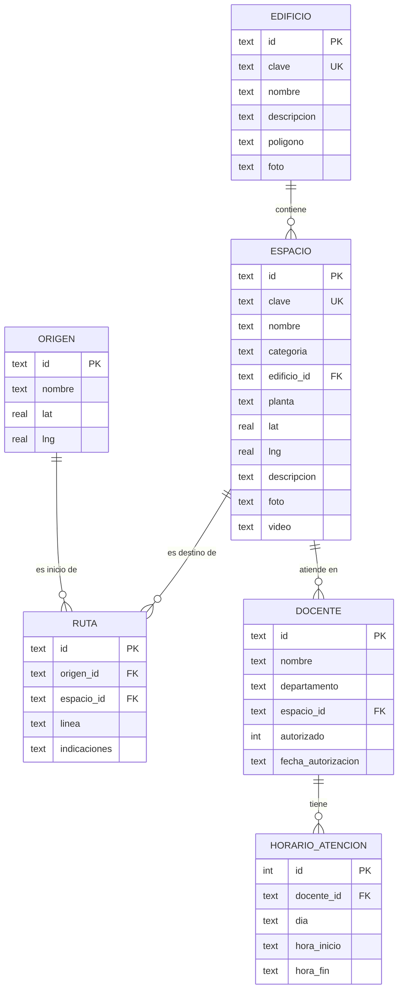

# Modelo de datos

Base de datos relacional en SQLite. El esquema completo está en [`db/esquema.sql`](../db/esquema.sql) (EDT 4.2 y 4.3).

## Reglas importantes

- `espacio.categoria` solo acepta `aula`, `laboratorio`, `departamento`, `oficina` o `servicio`.
- Un docente no puede tener `autorizado = 1` sin `fecha_autorizacion` (restricción `CHECK`).
- La API consulta docentes **solo** a través de la vista `docente_publico`, que filtra `autorizado = 1` (RNF-03).
- Los contornos y rutas se guardan como texto GeoJSON, dibujados en geojson.io.

## Cómo se llena

Los datos se capturan en `datos/*.json` y `datos/*.geojson` (ver [datos/README.md](../datos/README.md)) y `npm run db:crear` los inserta en la base. Así los cambios de datos se revisan en GitHub como cualquier otro cambio.
